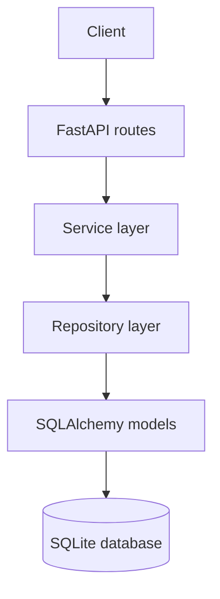

# Short URL Service

A REST API for creating compact links and redirecting visitors to their original destinations. Built with **FastAPI**, **SQLAlchemy 2.x**, **SQLite**, and **Pydantic v2**.

The service stores each URL mapping in a database, so generated links remain available after an application restart.

## Features

- Create short links through a versioned REST API.
- Redirect short links using HTTP `307 Temporary Redirect`.
- Retrieve a link's stored details without following the redirect.
- Generate cryptographically random, case-sensitive alphanumeric codes.
- Enforce code uniqueness with a database constraint and retry collisions.
- Validate submitted URLs and accept only absolute `http` and `https` URLs.
- Persist records with UTC timestamps.
- Return controlled JSON errors without exposing SQL statements or stack traces.
- Keep API, service, repository, model, and schema responsibilities separate.
- Run automated tests against isolated SQLite databases.
- Expose interactive OpenAPI documentation through FastAPI.

## Technology stack

| Area | Technology |
| --- | --- |
| Language | Python 3.11+ |
| API framework | FastAPI |
| ASGI server | Uvicorn |
| Database | SQLite (initial implementation) |
| ORM | SQLAlchemy 2.x |
| Request/response validation | Pydantic v2 |
| Configuration | Environment variables and `.env` |
| Tests | pytest, FastAPI TestClient, HTTPX |

## Architecture



- **API layer** handles HTTP requests, dependency injection, and response construction.
- **Service layer** contains URL validation, short-code generation, collision retries, and business rules.
- **Repository layer** owns database queries, commits, rollbacks, and database-error translation.
- **Database/model layer** defines the SQLAlchemy engine, session dependency, declarative base, and `urls` table.

Routes do not issue SQL queries or own business logic. The repository is the only layer that directly accesses SQLAlchemy sessions.

## Project structure

```text
short-url-service/
├── app/
│   ├── main.py
│   ├── api/
│   │   └── routes.py
│   ├── core/
│   │   ├── config.py
│   │   └── exceptions.py
│   ├── database/
│   │   ├── base.py
│   │   └── connection.py
│   ├── models/
│   │   └── url.py
│   ├── repositories/
│   │   └── url_repository.py
│   ├── schemas/
│   │   └── url.py
│   └── services/
│       ├── code_generator.py
│       ├── url_service.py
│       └── url_validator.py
├── tests/
├── .github/
│   └── workflows/
│       └── ci.yml
├── .env.example
├── .gitignore
├── LICENSE
├── pytest.ini
├── requirements.txt
└── requirements-dev.txt
```

## Getting started

### Prerequisites

- Python 3.11 or newer
- Git

### 1. Clone the repository

Replace `<your-username>` with your GitHub username:

```bash
git clone https://github.com/<your-username>/short-url-service.git
cd short-url-service
```

### 2. Create and activate a virtual environment

**macOS / Linux**

```bash
python3 -m venv .venv
source .venv/bin/activate
```

**Windows PowerShell**

```powershell
py -m venv .venv
.venv\Scripts\Activate.ps1
```

### 3. Install dependencies

```bash
python -m pip install --upgrade pip
pip install -r requirements-dev.txt
```

For a runtime-only installation, use `requirements.txt`.

### 4. Configure the application (optional)

The defaults are suitable for local development. To override them, copy the example file:

```bash
# macOS / Linux
cp .env.example .env

# Windows PowerShell
Copy-Item .env.example .env
```

Edit `.env` as needed. Do not commit `.env` or place credentials in source control.

### 5. Start the API

Run this command from the repository root:

```bash
uvicorn app.main:app --reload
```

The application is available at:

| Resource | URL |
| --- | --- |
| API base | `http://localhost:8000` |
| Swagger UI | `http://localhost:8000/docs` |
| ReDoc | `http://localhost:8000/redoc` |
| OpenAPI schema | `http://localhost:8000/openapi.json` |
| Health check | `http://localhost:8000/health` |

The SQLite database defaults to `short_url.db` in the working directory. Tables are created when the application starts if they do not already exist.

## API reference

| Method | Endpoint | Success | Purpose |
| --- | --- | --- | --- |
| `POST` | `/api/v1/urls` | `201 Created` | Create a short link |
| `GET` | `/api/v1/urls/{short_code}` | `200 OK` | Retrieve link details |
| `GET` | `/{short_code}` | `307 Temporary Redirect` | Redirect to the original URL |
| `GET` | `/health` | `200 OK` | Liveness check |

### Create a short URL

```bash
curl -X POST "http://localhost:8000/api/v1/urls" \
  -H "Content-Type: application/json" \
  -d '{"original_url":"https://www.example.com/products/mobile"}'
```

Example response (the generated code and timestamp will differ):

```json
{
  "original_url": "https://www.example.com/products/mobile",
  "short_code": "aB91xYz",
  "short_url": "http://localhost:8000/aB91xYz",
  "created_at": "2026-11-09T10:00:00.123456Z"
}
```

### Retrieve link details

This endpoint returns the stored mapping and does not issue a redirect:

```bash
curl "http://localhost:8000/api/v1/urls/aB91xYz"
```

### Follow a short URL

```bash
curl -i "http://localhost:8000/aB91xYz"
```

The response uses `307 Temporary Redirect` and includes a `Location` header containing the original URL.

### Health check

```bash
curl "http://localhost:8000/health"
```

Example response:

```json
{"status":"healthy"}
```

The health endpoint is a liveness check; it does not verify database connectivity.

## Validation and error handling

Only absolute `http://` and `https://` URLs are accepted. The validator rejects empty values, unsupported schemes, malformed hosts and ports, embedded credentials, whitespace/control characters, and URLs that exceed `MAX_URL_LENGTH`. Surrounding whitespace is trimmed.

A URL passing validation is not necessarily trustworthy. The service stores the destination and redirects the visitor; it does not fetch the submitted URL from the application server.

Errors use a stable JSON envelope:

```json
{
  "detail": "Short URL not found.",
  "code": "short_url_not_found"
}
```

| Condition | HTTP status | Error code |
| --- | ---: | --- |
| Invalid request body or URL | `422` | `validation_error` |
| Unknown or malformed short code | `404` | `short_url_not_found` |
| Database unavailable | `503` | `database_unavailable` |
| Short-code generation retries exhausted | `503` | `code_generation_failed` |
| Database write failure | `500` | `database_error` |
| Unexpected application error | `500` | `internal_error` |

For `422` responses, `detail` contains sanitized validation issues. For other errors, `detail` is a message string. Internal exception details are logged server-side and are not returned to API clients.

## Configuration

Settings can be provided through environment variables or a `.env` file. Values in the process environment take precedence over values in `.env`.

| Variable | Default | Description |
| --- | --- | --- |
| `DATABASE_URL` | `sqlite:///./short_url.db` | SQLAlchemy database connection URL |
| `BASE_URL` | `http://localhost:8000` | Public origin used to build short links; include scheme, host, and optional port only |
| `SHORT_CODE_LENGTH` | `7` | Generated code length; allowed range is 4–16 |
| `MAX_CODE_RETRIES` | `5` | Maximum attempts to allocate a unique code |
| `MAX_URL_LENGTH` | `2048` | Maximum accepted original URL length |
| `LOG_LEVEL` | `INFO` | One of `CRITICAL`, `ERROR`, `WARNING`, `INFO`, or `DEBUG` |

Invalid configuration values cause startup/configuration to fail with a clear error.

## Database model

The initial implementation uses a single `urls` table:

| Column | Type | Notes |
| --- | --- | --- |
| `id` | Integer | Primary key |
| `original_url` | Text | Required destination URL |
| `short_code` | `VARCHAR(16)` | Required, unique, indexed, case-sensitive code |
| `created_at` | DateTime | Required UTC timestamp |
| `updated_at` | DateTime | Nullable; reserved for future update support |

The application stores UTC timestamps consistently. Because SQLite does not preserve timezone metadata in a `DATETIME` column, a SQLAlchemy type decorator stores naive UTC values and restores timezone-aware UTC values when reading them.

## Run the tests

From the repository root:

```bash
pytest
```

The test suite uses isolated in-memory SQLite databases for API and repository tests. A separate temporary file database is used to verify persistence across application restarts. Tests cover URL validation, API request handling, redirection, code generation, collision handling, database constraints, configuration, and controlled errors.

GitHub Actions runs the test suite on Python 3.11, 3.12, and 3.13 for pushes and pull requests.

## Design decisions

- **Database uniqueness is authoritative.** The service checks whether a code exists before insertion, but the unique database constraint handles concurrent requests that race for the same code. Conflicts are rolled back and retried.
- **Short codes are case-sensitive.** Uppercase and lowercase letters are distinct. If migrating to a database with case-insensitive default collations, configure a case-sensitive/binary collation for `short_code`.
- **Redirects use HTTP 307.** This is a temporary redirect and avoids declaring the mapping permanent to clients and intermediaries.
- **Repeated submissions create separate links.** The same original URL can receive multiple short codes; URL de-duplication is not implemented.
- **Malformed codes are rejected early.** Codes outside the generated length/character range return `404` without a database query.

## Production considerations and future work

This repository is a focused initial implementation, not a complete hardened public URL-shortening platform. Before exposing it to the public Internet, consider:

- Rate limiting and abuse detection on the create endpoint.
- HTTPS termination and a production `BASE_URL`.
- Monitoring, structured logs, backups, and operational alerting.
- Link reporting, takedown, and destination block-list workflows.
- A longer `SHORT_CODE_LENGTH` for higher-volume deployments.
- Database migrations (for example, Alembic) instead of relying on `create_all` for schema evolution.
- PostgreSQL support for multi-instance deployments.
- Link expiry, custom aliases, click analytics, and authentication if required by the product.

## License

This project is licensed under the MIT License. See [LICENSE](LICENSE).
