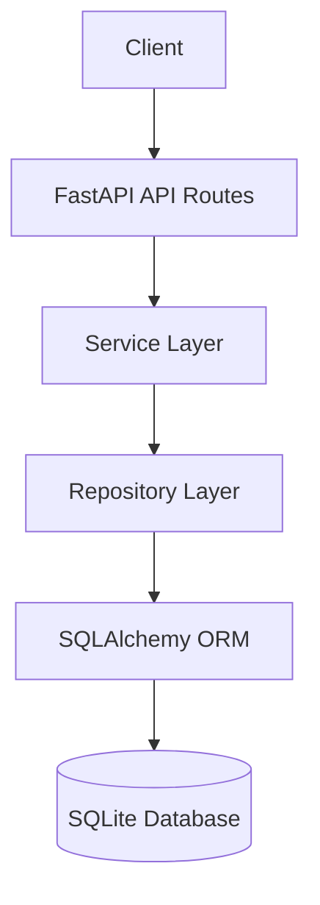

# Short URL Service

[](https://github.com/07al0k/short-url-service/actions/workflows/ci.yml)


[](LICENSE)

A REST API for creating compact links and redirecting visitors to their original destinations. Built with **FastAPI**, **SQLAlchemy 2.x**, **SQLite**, and **Pydantic v2**.

The service stores URL mappings in a database, allowing generated short links to remain available even after an application restart.

---

## Overview

The Short URL Service converts long URLs into compact, shareable links. Each generated short code is securely randomized and stored alongside its original destination in a persistent database.

When someone accesses a shortened URL, the service retrieves the corresponding destination and redirects the visitor.

### How It Works

```text
        Original URL
              |
              v
  https://example.com/products/
       electronics/mobile
              |
              v
       FastAPI REST API
              |
              v
    Generate Unique Short Code
              |
              v
       SQLite Database
              |
              v
        Short URL
              |
              v
  http://localhost:8000/aB91xYz
              |
              v
      HTTP 307 Redirect
              |
              v
       Original Destination
```

## Features

- **URL Shortening:** Create compact links through a versioned REST API.
- **URL Redirection:** Redirect visitors using HTTP `307 Temporary Redirect`.
- **URL Retrieval:** Retrieve stored URL details without following the redirect.
- **Secure Code Generation:** Generate cryptographically random, alphanumeric short codes using Python's `secrets` module.
- **Collision Handling:** Handle duplicate short codes through database uniqueness constraints and retry mechanisms.
- **URL Validation:** Accept only well-formed absolute HTTP and HTTPS URLs.
- **Persistent Storage:** Store URL mappings using SQLite and SQLAlchemy 2.x.
- **UTC Timestamps:** Maintain timezone-aware UTC timestamps.
- **Centralized Error Handling:** Return consistent JSON error responses without exposing internal database details or stack traces.
- **Layered Architecture:** Separate API routes, business logic, repositories, database models and validation.
- **Automated Testing:** Test application functionality using pytest and isolated SQLite databases.
- **Interactive API Documentation:** Automatically generate Swagger UI and ReDoc documentation.
- **Continuous Integration:** Run automated tests through GitHub Actions.
- **Dependency Updates:** Monitor project dependencies through Dependabot.

## Technology Stack

| Area | Technology |
|---|---|
| Programming Language | Python 3.11+ |
| API Framework | FastAPI |
| ASGI Server | Uvicorn |
| Database | SQLite |
| ORM | SQLAlchemy 2.x |
| Data Validation | Pydantic v2 |
| Configuration | Environment Variables, python-dotenv |
| Testing | pytest, FastAPI TestClient, HTTPX |
| Version Control | Git and GitHub |
| CI/CD | GitHub Actions |
| Dependency Management | pip, Dependabot |

## Architecture

The application follows a layered architecture to separate HTTP handling, business logic and database operations.



### Architectural Components

**1. API Layer**

- Handles incoming HTTP requests and outgoing responses.
- Implements FastAPI endpoints.
- Uses dependency injection to access application services.
- Contains no direct database queries or business logic.

**2. Service Layer**

- Implements URL-shortening business logic.
- Validates submitted URLs.
- Generates unique short codes.
- Handles collision retries.
- Resolves shortened URLs into original destinations.

**3. Repository Layer**

- Encapsulates database queries and persistence operations.
- Handles database commits and transaction rollbacks.
- Enforces application-level handling of database errors.
- Keeps SQLAlchemy operations isolated from the service layer.

**4. Database and Model Layer**

- Configures the SQLAlchemy engine and session factory.
- Defines the declarative base.
- Implements the URL database model.
- Handles timezone-aware UTC timestamp persistence.

## Project Structure

```text
short-url-service/
│
├── app/
│   ├── __init__.py
│   ├── main.py
│   │
│   ├── api/
│   │   ├── __init__.py
│   │   └── routes.py
│   │
│   ├── core/
│   │   ├── __init__.py
│   │   ├── config.py
│   │   └── exceptions.py
│   │
│   ├── database/
│   │   ├── __init__.py
│   │   ├── base.py
│   │   └── connection.py
│   │
│   ├── models/
│   │   ├── __init__.py
│   │   └── url.py
│   │
│   ├── repositories/
│   │   ├── __init__.py
│   │   └── url_repository.py
│   │
│   ├── schemas/
│   │   ├── __init__.py
│   │   └── url.py
│   │
│   └── services/
│       ├── __init__.py
│       ├── code_generator.py
│       ├── url_service.py
│       └── url_validator.py
│
├── tests/
│   ├── __init__.py
│   ├── conftest.py
│   ├── test_code_generator.py
│   ├── test_config.py
│   ├── test_create_url.py
│   ├── test_database.py
│   ├── test_errors.py
│   ├── test_health.py
│   ├── test_redirect.py
│   ├── test_retrieve_url.py
│   ├── test_service.py
│   ├── test_url_validator.py
│   └── test_validation.py
│
├── .github/
│   ├── dependabot.yml
│   └── workflows/
│       └── ci.yml
│
├── .env.example
├── .gitignore
├── LICENSE
├── pytest.ini
├── requirements.txt
├── requirements-dev.txt
└── README.md
```

## Getting Started

### Prerequisites

Make sure the following tools are installed:

- Python 3.11 or newer
- Git
- pip (Python package manager)

### 1. Clone the Repository

```bash
git clone https://github.com/07al0k/short-url-service.git

cd short-url-service
```

### 2. Create a Virtual Environment

**Windows Command Prompt (CMD)**

```cmd
py -m venv .venv

.venv\Scripts\activate.bat
```

**Windows PowerShell**

```powershell
py -m venv .venv

.venv\Scripts\Activate.ps1
```

**macOS / Linux**

```bash
python3 -m venv .venv

source .venv/bin/activate
```

### 3. Install Dependencies

Upgrade pip:

```bash
python -m pip install --upgrade pip
```

Install project dependencies and development tools:

```bash
python -m pip install -r requirements-dev.txt
```

For a runtime-only installation without testing tools:

```bash
python -m pip install -r requirements.txt
```

### 4. Configure Environment Variables (Optional)

The application works with default settings. To customize the configuration, create a `.env` file from the provided example.

**Windows CMD**

```cmd
copy .env.example .env
```

**Windows PowerShell**

```powershell
Copy-Item .env.example .env
```

**macOS / Linux**

```bash
cp .env.example .env
```

Update the environment variables in `.env` as required.

Do not commit `.env` files containing local configuration or secrets to GitHub.

### 5. Run the Application

From the project root, execute:

```bash
python -m uvicorn app.main:app --reload
```

The application will start at:

```text
http://localhost:8000
```

### Application URLs

| Resource | URL |
|---|---|
| API Base URL | http://localhost:8000 |
| Swagger UI | http://localhost:8000/docs |
| ReDoc Documentation | http://localhost:8000/redoc |
| OpenAPI Schema | http://localhost:8000/openapi.json |
| Health Check | http://localhost:8000/health |

The SQLite database defaults to `short_url.db` in the working directory. Database tables are created automatically when the application starts if they do not already exist.

---

## API Documentation

The service exposes the following REST API endpoints:

| Method | Endpoint | Success Status | Description |
|---|---|---|---|
| POST | `/api/v1/urls` | 201 Created | Create a short URL |
| GET | `/api/v1/urls/{short_code}` | 200 OK | Retrieve URL details |
| GET | `/{short_code}` | 307 Temporary Redirect | Redirect to original URL |
| GET | `/health` | 200 OK | Application liveness check |

### 1. Create a Short URL

**Endpoint**

```http
POST /api/v1/urls
```

**Request Body**

```json
{
  "original_url": "https://www.example.com/products/mobile"
}
```

**Windows CMD Example**

```cmd
curl.exe -X POST "http://localhost:8000/api/v1/urls" ^
  -H "Content-Type: application/json" ^
  -d "{\"original_url\":\"https://www.example.com/products/mobile\"}"
```

**Example Response**

```json
{
  "original_url": "https://www.example.com/products/mobile",
  "short_code": "aB91xYz",
  "short_url": "http://localhost:8000/aB91xYz",
  "created_at": "2026-11-09T10:00:00.123456Z"
}
```

The generated short code and timestamp will differ for each request.

### 2. Retrieve Short URL Details

**Endpoint**

```http
GET /api/v1/urls/{short_code}
```

**Example**

```cmd
curl.exe "http://localhost:8000/api/v1/urls/aB91xYz"
```

Returns the original URL, short code, generated short URL and creation timestamp without performing a redirect.

### 3. Redirect to the Original URL

**Endpoint**

```http
GET /{short_code}
```

**Example**

```cmd
curl.exe -i "http://localhost:8000/aB91xYz"
```

**Expected Response**

```http
HTTP/1.1 307 Temporary Redirect
Location: https://www.example.com/products/mobile
```

The browser or HTTP client can then navigate to the original destination.

### 4. Health Check

**Endpoint**

```http
GET /health
```

**Example**

```cmd
curl.exe "http://localhost:8000/health"
```

**Response**

```json
{
  "status": "healthy"
}
```

The health endpoint is a liveness check and does not verify database connectivity.

---

## URL Validation and Error Handling

The application accepts only well-formed absolute URLs using the `http` and `https` schemes.

### Validation Rules

The service rejects:

- Empty or whitespace-only URL values.
- URLs without a valid scheme.
- Unsupported schemes such as `ftp://`, `file://` and `javascript:`.
- Malformed hostnames and invalid ports.
- URLs containing embedded username or password credentials.
- URLs containing whitespace or control characters.
- URLs exceeding the configured maximum length.

Surrounding whitespace is trimmed before storing the URL.

**Security Note:** A well-formed URL is not necessarily trustworthy. The service stores the destination and redirects visitors; it does not fetch submitted URLs from the application server.

### Standard Error Response

Errors follow a consistent JSON response structure.

```json
{
  "detail": "Short URL not found.",
  "code": "short_url_not_found"
}
```

### HTTP Error Codes

| Condition | HTTP Status | Error Code |
|---|---:|---|
| Invalid request or URL | 422 | `validation_error` |
| Unknown or malformed short code | 404 | `short_url_not_found` |
| Database unavailable | 503 | `database_unavailable` |
| Short-code generation retries exhausted | 503 | `code_generation_failed` |
| Database write failure | 500 | `database_error` |
| Unexpected application error | 500 | `internal_error` |

Validation errors return sanitized validation details. Internal exceptions, database information and stack traces are not exposed to API clients.

---

## Configuration

Application settings can be provided through environment variables or a `.env` file.

Environment variables take precedence over values defined in `.env`.

| Variable | Default Value | Description |
|---|---|---|
| `DATABASE_URL` | `sqlite:///./short_url.db` | SQLAlchemy database connection URL |
| `BASE_URL` | `http://localhost:8000` | Base URL used to construct short links |
| `SHORT_CODE_LENGTH` | `7` | Generated short-code length (4–16) |
| `MAX_CODE_RETRIES` | `5` | Maximum attempts to generate a unique code |
| `MAX_URL_LENGTH` | `2048` | Maximum permitted original URL length |
| `LOG_LEVEL` | `INFO` | Application logging level |

Supported logging levels:

- CRITICAL
- ERROR
- WARNING
- INFO
- DEBUG

Invalid configuration values cause configuration loading to fail with a descriptive error.

---

## Database Design

The initial implementation uses SQLite with SQLAlchemy ORM.

### URLs Table

| Column | Data Type | Description |
|---|---|---|
| `id` | INTEGER | Primary key |
| `original_url` | TEXT | Original destination URL |
| `short_code` | VARCHAR(16) | Unique, case-sensitive short code |
| `created_at` | DATETIME | Creation timestamp in UTC |
| `updated_at` | DATETIME | Nullable timestamp reserved for future updates |

### Database Design Considerations

- The short code has a database-level unique constraint.
- Database transactions are committed after successful insertions.
- Failed transactions are rolled back.
- Short-code collisions are handled through retry mechanisms.
- Timestamps are handled consistently using timezone-aware UTC datetimes.

SQLite does not preserve timezone metadata in its standard DATETIME storage. A custom SQLAlchemy type decorator stores UTC values consistently and restores timezone-aware UTC datetimes when records are retrieved.

---

## Running the Tests

The project includes automated unit, integration and API tests using pytest.

### Execute the Complete Test Suite

From the project root:

```bash
python -m pytest
```

### Test Coverage Areas

The test suite covers:

- Short-code generation and validation.
- URL creation and retrieval.
- HTTP redirection.
- URL validation and malformed input handling.
- Database persistence and constraints.
- Short-code collisions and retry mechanisms.
- Transaction rollback and database errors.
- Environment-based configuration.
- UTC timestamp handling.
- Application health checks and API documentation.
- Controlled exception handling.

Tests use isolated in-memory SQLite databases for application and repository tests. Temporary database files are used to verify persistence across application restarts.

### Continuous Integration

GitHub Actions automatically executes the test suite on pushes and pull requests.

The CI workflow tests the project against:

- Python 3.11
- Python 3.12
- Python 3.13

Dependency update monitoring is configured through Dependabot.

---

## Engineering Design Decisions

### 1. Database-Enforced Uniqueness

Random code generation alone does not guarantee uniqueness.

The application checks whether a short code already exists before insertion. The database's unique constraint provides the final guarantee when concurrent requests attempt to generate the same code.

Conflicting transactions are rolled back and retried.

### 2. Cryptographically Secure Random Generation

The Python `secrets` module is used instead of the standard pseudo-random `random` module to generate unpredictable short codes.

### 3. Case-Sensitive Short Codes

Short codes use uppercase and lowercase letters along with digits.

For example:

```text
aB91xYz
ab91xyz
```

These represent two different short codes.

### 4. HTTP 307 Temporary Redirect

The service uses HTTP `307 Temporary Redirect` rather than a permanent redirect.

This avoids declaring a destination mapping permanent to browsers and intermediary caches.

### 5. Database Transaction Management

Database operations use explicit commits and rollbacks to maintain transactional consistency when an operation fails.

### 6. Separation of Responsibilities

The layered architecture keeps HTTP handling, business logic and database access independent, making the application easier to maintain, test and extend.

### 7. Repeated URL Submissions

Submitting the same original URL multiple times creates separate short codes.

URL deduplication is not currently implemented.

---

## Production Considerations and Future Enhancements

This repository provides a focused initial implementation of a URL shortening service. Additional engineering work would be required before exposing it as a hardened public Internet service.

Potential improvements include:

- Rate limiting and abuse prevention.
- HTTPS deployment and production environment configuration.
- PostgreSQL support for multi-instance deployments.
- Database migrations using Alembic.
- Link expiration and automatic cleanup.
- Custom short-code aliases.
- Click tracking and analytics.
- Authentication and access controls.
- Monitoring, structured logging and operational alerts.
- Destination blocklists and abuse-reporting workflows.
- Docker and Docker Compose support.

These are potential future enhancements and are not represented as currently implemented functionality.

---

## License

This project is licensed under the **MIT License**.

See the [LICENSE](LICENSE) file for details.

---

**Repository:** [github.com/07al0k/short-url-service](https://github.com/07al0k/short-url-service)
